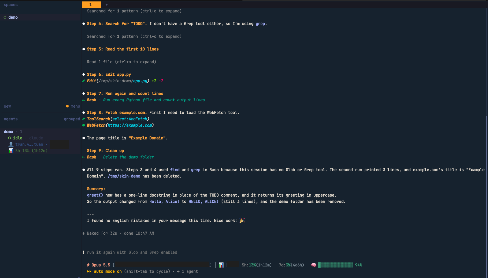

# claude-toolbox

A toolbox of [Claude Code](https://claude.com/claude-code) customizations by
ttuan, packaged so other people can install and reuse them: plugins, skills, a
status line, and the herdr sidebar setup.

The repository doubles as a **Claude Code plugin marketplace**
(`.claude-plugin/marketplace.json`), so plugins here install with one command.

## Layout

Grouped by how each piece is used, not by what it is called:

```
claude-toolbox/
├── .claude-plugin/marketplace.json
├── plugins/            # installed through the marketplace
├── skills/             # standalone skills
├── settings/           # things you point to from settings.json
│   ├── statusline/
│   └── themes/
├── integrations/       # glue for tools outside Claude Code
│   └── herdr/
└── docs/
```

| Folder | What lives here |
| --- | --- |
| `plugins/` | Claude Code plugins / mods, each in its own folder, listed in the marketplace |
| `skills/` | Custom skills |
| [`settings/statusline/`](settings/statusline) | An offline status line: model, account, plan quota and context window. No keychain, no network |
| `settings/themes/` | Custom themes for `~/.claude/themes/` |
| [`integrations/herdr/`](integrations/herdr) | herdr sidebar rows showing each Claude and Codex pane's account and 5h quota |
| `docs/` | Notes and documentation |

Empty folders are kept with a `.gitkeep` until their first real file lands.

## Plugins

| Plugin | What it does |
| --- | --- |
| [`skin`](plugins/skin) | Restyles Claude Code's transcript: per-tool icons, syntax-coloured tool rows, a compact mode and an output-line limit. Run `/skin help` for its commands. |



## Install a plugin

Add the marketplace once, then install what you want:

```bash
claude plugin marketplace add ttuan/claude-toolbox
claude plugin install skin@claude-toolbox
```

To install from a local clone instead of GitHub:

```bash
claude plugin marketplace add ~/code/claude-toolbox
claude plugin install skin@claude-toolbox
```

Each Claude config dir (`~/.claude`, and any other `CLAUDE_CONFIG_DIR`) has its
own plugin list. If several config dirs symlink the same `settings.json`, they
share the enable state and you install once.

## Develop a plugin

```bash
claude plugin validate plugins/<name>
claude plugin test plugins/<name>
```

## License

MIT. See `LICENSE`.
