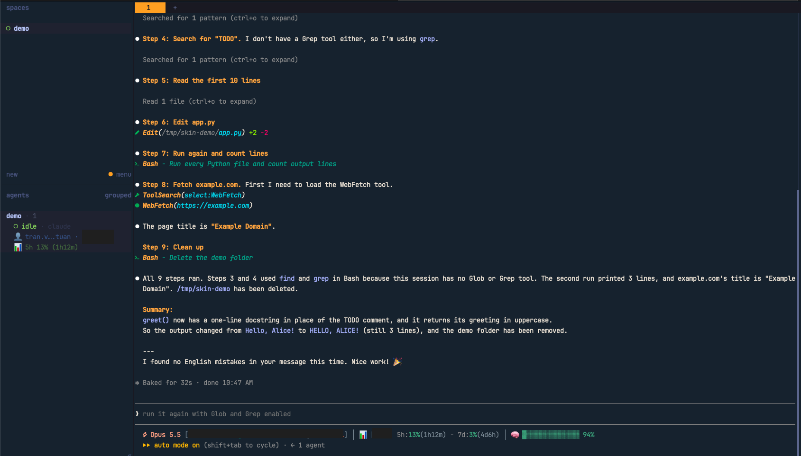

# skin

A Claude Code mod that restyles how the transcript looks. Today it redraws the
tool-call rows; the plan is to grow it into a configurable skin for Claude
Code's display (colour palettes, output styling).



*Tool details hidden with `/skin details hide`: one line per call, a per-tool
icon, the summary in teal, and the lines an Edit added and removed.*

## What it does now

It hooks `ui.render` for the `ToolUse`, `ToolGroup`, `ToolResult` and
`AssistantMessage` components and redraws each tool call:

- **Per-tool icons** (Nerd Font) in place of the `⏺` bullet, coloured by the
  call's state: running, done, interrupted, failed.
- **Bash commands** are tokenised and coloured: the command name of each simple
  command, keywords, strings, variables, flags and numbers. A leading
  `NAME=value` env prefix is kept faint so the real command stands out.
- **Summary line**: the call's description sits next to the tool name, in teal
  italics, joined with a dash.
- **Read, Edit, Write, Glob, Grep** show their path or pattern, with the folder
  dimmed and the file name highlighted.
- **Skill** calls show the skill's name as the summary, like a Bash description,
  with its arguments under it (on the same line when details are hidden).
- **Other tools** (WebFetch, ToolSearch, MCP tools, ...) get an icon, their name
  and one key argument such as the URL or query.
- **Folded reads and searches**: the run of Glob, Grep and Read calls that
  Claude Code folds into one count line (`ToolGroup`) is drawn as one row per
  call instead. ctrl+o still shows the engine's view.
- **Spacing**: a blank line sits between a reply text and the tool call after
  it; a tool call and the text after it, and consecutive tool calls, sit
  together.
- Agent, AskUserQuestion, plan and task tools are left to the engine.

The colours are a Monokai-style palette tuned for a dark background.

## Install

```bash
claude plugin marketplace add ttuan/claude-toolbox
claude plugin install skin@claude-toolbox
```

Icons need a [Nerd Font](https://www.nerdfonts.com/) in your terminal.

## Commands

Every command is `/skin` followed by what you want to change. Each answer is a
full sentence saying what changed, and every choice carries over to later
sessions.

| Command | What it does |
| --- | --- |
| `/skin` | Show the current settings |
| `/skin help` | List every command |
| `/skin colors on` / `off` | Turn tool-row colours on or off |
| `/skin details hide` / `show` | Hide tool details (one line per call) or show them |
| `/skin output 3` | Show only the first 3 lines of each tool's output |
| `/skin output all` | Show every line of output |
| `/skin output default` | Let Claude Code decide, as without the plugin |
| `/skin reset` | Go back to the defaults |

Word order is loose, and filler words are fine, so these all work:

```text
/skin hide details
/skin show 3 lines
/skin limit output to 3 lines
/skin turn colors off
/skin show all output
```

A command it cannot read is never guessed: `/skin` says what it did not
understand and lists the commands. A value left out, as in `/skin colors`, gets a
hint for the right form.

`/skin` alone prints something like:

```text
skin settings
  Colors:   on
  Details:  shown
  Output:   the first 3 lines
```

### Hide details

`/skin details hide` leaves one line per tool call: the icon, the tool name and
its summary.

```text
 Bash - Run the test suite
 Edit(hooks/register.tsx) +12 -3
```

Bash shows its description, or the start of the command when it has none. Edit
and Write show the path and the lines changed. Output and diffs are hidden.

- Press ctrl+o to see the full call and its output.
- A failed call still shows its error.
- Permission dialogs still show the full command.
- Agent, AskUserQuestion, plan and task tools are left as they are.
- Only the display changes: the model reads the same output, so no tokens are saved.

### Limit output

`/skin output <n>` sets how many lines of Bash, Edit and Write output a tool row
draws.

- `3` draws three lines, then `… +N lines (ctrl+o to expand)`.
- `0` draws only the `… +N lines` hint.
- `all` draws every line.
- `default` goes back to Claude Code's own rows.

Hidden details win: while details are hidden, no output is drawn, and
`/skin output` says so. Errors, ctrl+o and other tools (Read, Grep, MCP tools)
keep Claude Code's rows.

### Old command names

`/skin compact on` and `/skin compact off` still work and mean
`/skin details hide` and `/skin details show`.

## Settings in /config

- **Highlight tool rows**: whether colours start on. `/skin colors` overrides it,
  and `/skin reset` goes back to it.
- **Max length to highlight**: commands or paths longer than this many
  characters are not coloured, to stay cheap on huge inputs.
